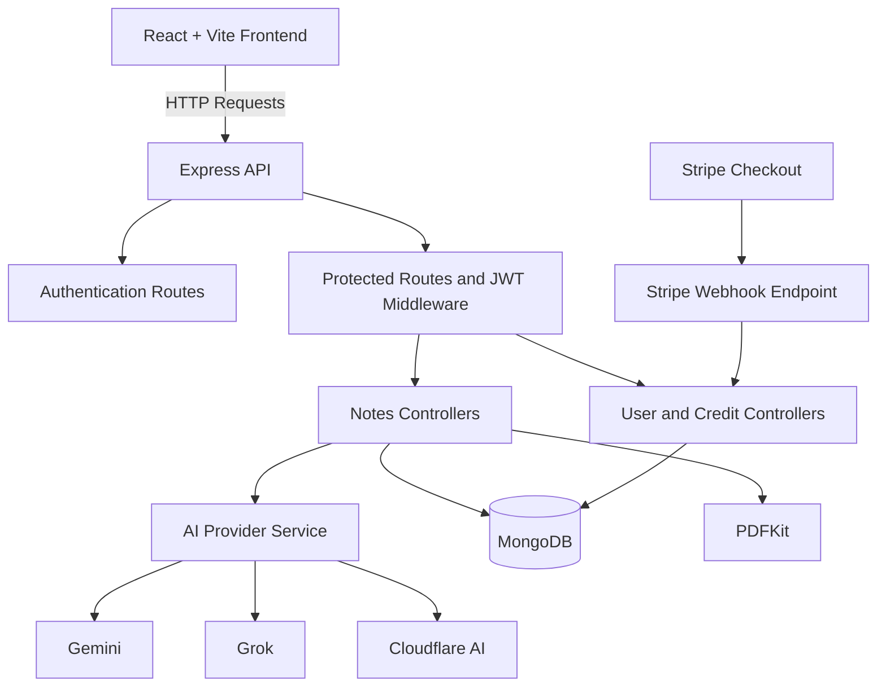

# AI Exam Notes Generator

An AI-powered study platform that turns a topic into structured, exam-focused notes with multiple AI providers, revision material, optional diagrams and charts, saved history, and PDF export.

**Repository:** [PrajapatiSandeep2005/AiExamNotesGenerator-1.0-](https://github.com/PrajapatiSandeep2005/AiExamNotesGenerator-1.0-)

---

## Table of Contents

- [Overview](#overview)
- [Features](#features)
- [Screenshots](#screenshots)
- [Technology Stack](#technology-stack)
- [Architecture](#architecture)
- [Project Structure](#project-structure)
- [Prerequisites](#prerequisites)
- [Getting Started](#getting-started)
- [Environment Variables](#environment-variables)
- [AI Providers](#ai-providers)
- [Usage and Credits](#usage-and-credits)
- [API Reference](#api-reference)
- [Available Scripts](#available-scripts)
- [Deployment](#deployment)
- [Troubleshooting](#troubleshooting)
- [Security Notes](#security-notes)
- [Author](#author)

## Overview

**AI Exam Notes Generator** is a full-stack study application built to help students prepare for exams more efficiently. Enter a topic, choose an academic level and exam type, configure the generation options, and create organized study material.

Instead of returning only a general chat response, the application structures generated content into detailed notes, important subtopics, revision points, and exam-style questions. Users can save their notes, return to them later, and export them as PDFs.

The backend supports Gemini, Grok, and Cloudflare AI. Users can select a provider directly or choose **Auto** to try configured providers in sequence when generation fails or produces an invalid response structure.

## Features

### AI-Powered Exam Notes

- Generate notes from a topic, class level, and exam type.
- Choose detailed notes or a concise revision mode.
- Generate revision points and short- and long-answer questions.
- Optionally include Mermaid diagrams and Recharts visualizations.

### Multiple AI Providers

- Supports Google Gemini, xAI Grok, and Cloudflare AI.
- Select a provider manually or use **Auto** fallback mode.
- In Auto mode, the backend tries Gemini, then Grok, then Cloudflare AI, moving to the next configured provider if generation fails or the response format is invalid.
- The provider used for a successful generation is included in the result and saved with the note.

### Authentication and Saved History

- Register and sign in with email and password.
- Sign in with Google through Firebase.
- Hash passwords with bcrypt.
- Use JWT-based sessions stored in an HTTP-only cookie.
- Save generated notes to the signed-in user's history and reopen them later.

### PDF Export

- Export generated notes to downloadable PDF documents.
- Generate PDFs on the backend with PDFKit.

### Usage Credits and Payments

- Includes 50 application-tracked free generations per user per UTC day, shared across supported AI providers.
- Allows additional generations using purchased credits after the daily free allowance is exhausted.
- Uses Stripe Checkout for credit purchases.
- Adds purchased credits after the backend verifies the Stripe webhook event.

### User Interface

- Responsive layouts.
- Light and dark themes with the preference saved in local storage.
- Animated UI elements and charts.
- Loading states and skeleton placeholders.
- A dedicated, scrollable interface for reading saved notes.

> **Provider quota note:** AI provider limits and model availability are controlled by the providers and can change. Any provider-limit figures displayed in this application are informational estimates, not live account balances or guaranteed quotas. Provider usage units differ and should not be added together.

## Screenshots

### Landing Page


### Sign In


### Google Sign-In


### Home Page


### Create Notes


### Notes History


### Credit Top-Up


## Technology Stack

| Area | Technologies |
|---|---|
| Frontend | React 19, Vite 8, React Router |
| State Management | Redux Toolkit |
| Styling and Animation | Tailwind CSS 4, Framer Motion (`motion`) |
| Visualizations | Recharts, Mermaid |
| Markdown Rendering | React Markdown |
| Backend | Node.js, Express 5 |
| Database | MongoDB, Mongoose |
| Authentication | Firebase Google Sign-In, bcrypt, JWT cookies |
| Payments | Stripe Checkout, signed webhook processing |
| PDF Generation | PDFKit |
| AI Providers | Google Gemini, xAI Grok, Cloudflare AI |

## Architecture



The frontend communicates with the Express backend. The backend handles authentication, note generation, data persistence, PDF creation, and credit purchases.

AI requests are routed through the provider service. Stripe payment credits are applied through webhook processing after the backend verifies the event signature.

## Project Structure

```text
AiExamNotesGenerator-1.0-/
│
├── client/
│   ├── src/
│   │   ├── components/       Shared UI, note forms/results, navigation, charts
│   │   ├── pages/            Home, authentication, notes, history, pricing, payments
│   │   ├── services/         Axios API client and request configuration
│   │   └── utils/            Theme, credit, Firebase, and note-formatting helpers
│   └── package.json
│
├── server/
│   ├── controllers/           Authentication, notes, PDF, and credit handlers
│   ├── middleware/            JWT authentication middleware
│   ├── models/                Mongoose user, notes, and payment models
│   ├── routes/                Express API route definitions
│   ├── services/              Gemini and multi-provider AI generation
│   ├── utils/                 Database, prompt, and credit helpers
│   └── package.json
│
└── README.md
```

## Prerequisites

Before running the application, install or configure:

- **Node.js:** 20.19+ or 22.12+
- **npm**
- **MongoDB:** Local installation or hosted database
- **AI provider credentials:** At least one supported provider
- **Firebase:** Required only if you want Google Sign-In
- **Stripe credentials:** Required only if you want to test credit purchases

## Getting Started

### 1. Clone the Repository

```bash
git clone https://github.com/PrajapatiSandeep2005/AiExamNotesGenerator-1.0-.git

cd AiExamNotesGenerator-1.0-
```

### 2. Install Dependencies

Install the backend dependencies:

```bash
cd server
npm install
```

Install the frontend dependencies:

```bash
cd ../client
npm install
```

### 3. Configure the Backend

Create a `server/.env` file using the example in the [Environment Variables](#environment-variables) section.

Configure MongoDB and at least one AI provider. Stripe variables are needed only if you want to test credit purchases.

### 4. Configure Firebase (Optional)

The Firebase frontend configuration is located at:

```text
client/src/utils/firebase.js
```

Configure your Firebase project and enable Google as a sign-in provider if you want to use Google Sign-In.

### 5. Configure the Frontend (Optional)

The Vite development setup defaults to `http://localhost:5000` for the backend.

If your backend uses a different base URL, create `client/.env`:

```env
VITE_API_URL=http://localhost:5000
```

Use the backend base URL only; do not append an API path such as `/api`.

### 6. Start the Application

Start the backend from one terminal:

```bash
cd server
npm run dev
```

Start the frontend from another terminal:

```bash
cd client
npm run dev
```

Open the Vite URL shown in the client terminal, normally `http://localhost:5173`.

The backend listens on port `5000` by default and connects to MongoDB during startup.

## Environment Variables

Create `server/.env`:

```env
PORT=5000
NODE_ENV=development
CLIENT_URL=http://localhost:5173
MONGO_URI=mongodb://127.0.0.1:27017/ai-exam-notes
JWT_SECRET=replace-with-a-long-random-secret

# Configure one or more AI providers
GEMINI_API_KEY=your-gemini-api-key
GROK_API_KEY=your-xai-api-key
# Optional: defaults to grok-4.7
GROK_MODEL=grok-4.7
CLOUDFLARE_ACCOUNT_ID=your-cloudflare-account-id
CLOUDFLARE_AUTH_TOKEN=your-cloudflare-api-token

# Optional: required for Stripe credit purchases and webhooks
STRIPE_SECRET_KEY=your-stripe-secret-key
STRIPE_WEBHOOK_SECRET=your-stripe-webhook-signing-secret
```

### Environment Variable Notes

- Configure only the AI providers you plan to use. Auto mode can try only providers that are configured and available.
- `XAI_API_KEY` is also accepted as an alternative to `GROK_API_KEY`.
- `GROK_MODEL` is optional; if omitted, the backend uses `grok-4.7`.
- The Cloudflare token may also be supplied as `CLOUDFLARE_API_TOKEN`.
- For local development, the backend allows `http://localhost:5173` and `http://localhost:3000`, plus the exact origin configured in `CLIENT_URL`.
- Keep backend secrets on the server. Never put AI provider or Stripe secret keys in frontend environment variables or commit `.env` files.
- Firebase client configuration is separate from these backend environment variables and is currently stored in `client/src/utils/firebase.js`.

## AI Providers

The model selector supports the following providers and models:

| Selection | Provider / Model | Required Backend Setting |
|---|---|---|
| Auto | Gemini → Grok → Cloudflare AI | Credentials for one or more providers |
| Gemini | Gemini Flash (`gemini-flash-latest`) | `GEMINI_API_KEY` |
| Grok | `grok-4.7` (or `GROK_MODEL`) | `GROK_API_KEY` or `XAI_API_KEY` |
| Cloudflare AI | `@cf/meta/llama-3.1-8b-instruct` | `CLOUDFLARE_ACCOUNT_ID` and a Cloudflare token |

Selecting a specific provider sends the request only to that provider.

Auto mode falls back sequentially when a provider fails or returns an invalid note structure. Requests can still fail if a provider is not configured, its model is unavailable, or the account has reached a provider-side limit.

### Displayed Provider Limits

The Notes page displays the following provider-limit estimates:

| Provider | Model Shown in the App | Displayed Estimate |
|---|---|---:|
| Gemini Flash | `gemini-flash-latest` | Up to 1,500 requests/day |
| Grok | Configured xAI model | Provider account limits vary |
| Cloudflare AI | Llama 3.1 8B | 10,000 neurons/day |

These are informational estimates shown by the application. They are not fetched from the user's provider account, may become outdated, and use units that are not directly comparable.

Cloudflare's neuron allowance should not be treated as a number of chats or requests.

The generation layer expects structured JSON containing notes, importance-grouped subtopics, revision points, questions, and optional diagram/chart data. The frontend renders the generated structure in the application and PDF export.

## Usage and Credits

### Daily Free Allowance

- Each user gets **50 generated chats per UTC day**.
- The allowance is shared across Gemini, Grok, and Cloudflare AI.
- The application tracks its own successful usage; it does not read provider account quotas.
- The allowance resets according to the UTC date.

### Purchased Credits

After the daily free allowance is exhausted, each generation costs **10 purchased credits**.

| Price | Credits | Paid Generations at 10 Credits Each |
|---:|---:|---:|
| ₹100 | 50 | 5 |
| ₹200 | 120 | 12 |
| ₹500 | 350 | 35 |

### Stripe Webhook

Credit purchases are processed through Stripe Checkout. The backend adds credits only after verifying the completed checkout webhook event; the browser redirect alone does not grant credits.

The webhook endpoint is:

```text
POST /api/credits/webhook
```

For local payment testing, use Stripe test credentials and configure Stripe to send events to your local backend using a webhook-forwarding tool such as the Stripe CLI.

## API Reference

All paths are relative to the backend origin. Routes marked **Authenticated** require a valid JWT session cookie.

| Method | Endpoint | Purpose | Authentication |
|---|---|---|---|
| `GET` | `/` | Backend health message | No |
| `POST` | `/api/auth/google` | Create or sign in to a Google-authenticated account | No |
| `POST` | `/api/auth/register` | Register with email and password | No |
| `POST` | `/api/auth/login` | Sign in with email and password | No |
| `POST` | `/api/auth/logout` | Clear the session cookie | Session-dependent |
| `GET` | `/api/user/currentuser` | Get the current user and usage snapshot | Session-dependent |
| `POST` | `/api/notes/generate-notes` | Generate and save notes | **Authenticated** |
| `GET` | `/api/notes/getnotes` | List the user's saved notes | **Authenticated** |
| `GET` | `/api/notes/:id` | Get a saved note | **Authenticated** |
| `POST` | `/api/pdf/generate-pdf` | Generate a PDF from supplied notes | **Authenticated** |
| `POST` | `/api/credit/order` | Create a Stripe Checkout session | **Authenticated** |
| `GET` | `/api/credit/history` | List the user's purchases | **Authenticated** |
| `POST` | `/api/credits/webhook` | Verify Stripe events and apply paid credits | Stripe signature |

The note-generation request accepts topic, class/exam details, revision and visual options, and an `aiModel` selection: `auto`, `gemini`, `groq`, or `cloudflare`.

Refer to the matching backend route and controller for the exact request schema, validation, and response format.

## Available Scripts

Run commands from the appropriate directory.

### Client (`client/`)

| Command | Purpose |
|---|---|
| `npm run dev` | Start the Vite development server |
| `npm run build` | Build the production frontend |
| `npm run preview` | Preview the production build locally |
| `npm run lint` | Run ESLint |

### Server (`server/`)

| Command | Purpose |
|---|---|
| `npm run dev` | Start the backend with the development watcher |
| `npm start` | Start the backend |

## Deployment

### Backend Configuration

Set these values in your backend hosting environment:

- `NODE_ENV=production`
- `CLIENT_URL` to the exact deployed frontend origin, including scheme and hostname but no path
- `MONGO_URI` to your production MongoDB connection string
- `JWT_SECRET` to a strong, unique production secret
- At least one AI provider credential
- `STRIPE_SECRET_KEY` and `STRIPE_WEBHOOK_SECRET` if credit purchases are enabled

Register the Stripe webhook endpoint `/api/credits/webhook` if using Stripe payments.

### Frontend Configuration

Set `VITE_API_URL` to the deployed backend's base URL, then rebuild and redeploy the frontend.

### Production Cookies and CORS

- Use HTTPS in production.
- Configure `CLIENT_URL` to match the frontend origin exactly.
- Ensure CORS and credentialed requests are configured for your deployment.
- The backend uses `Secure` and `SameSite=None` cookie settings in production for cross-site authentication.
- Restart or redeploy the backend after changing environment variables or allowed origins.

## Troubleshooting

### CORS Error in Local Development

Confirm the frontend origin is exactly `http://localhost:5173` or `http://localhost:3000`, as applicable, and that the frontend calls the intended backend.

For a custom origin, update `CLIENT_URL` to that exact origin and restart the backend.

### Authentication Appears Signed Out

Check the frontend and backend URLs, credentialed requests, CORS configuration, and cookie settings.

For cross-site production deployments, use HTTPS and ensure `CLIENT_URL` matches the frontend origin.

### AI Generation Fails

- Confirm that the selected provider's environment variables are configured on the backend.
- Verify that the provider key is active and the account has available capacity.
- Check backend logs for provider-specific errors.
- For Grok, confirm `GROK_API_KEY` (or `XAI_API_KEY`) and the configured `GROK_MODEL` are valid; the backend response includes xAI's error message.
- Try Auto mode to fall back to other configured providers.

The frontend should not require AI provider secret keys.

### Stripe Credits Do Not Appear

- Confirm that checkout completed successfully.
- Verify that the webhook targets `/api/credits/webhook`.
- Confirm that `STRIPE_WEBHOOK_SECRET` matches the configured webhook endpoint.
- Check backend logs and the Stripe event delivery status.

Credits are applied through verified webhook processing, not simply from the browser success redirect.

## Security Notes

- Never commit `.env` files or secrets to GitHub.
- Keep AI provider keys, `JWT_SECRET`, `STRIPE_SECRET_KEY`, and `STRIPE_WEBHOOK_SECRET` on the backend.
- Use HTTPS and secure cookie settings in production.
- Use Stripe's test mode when developing payment flows.

  
📸 Screenshots
Landing Page 


Signin Page 


SignIn page with google Oauth


Home Page


Create Notes Page


My Notes History Page


image
Credit Topup Page


## Author

**Author:** Sandeep Kumar Prajapati

Built with React, Node.js, MongoDB, and AI provider integrations.
